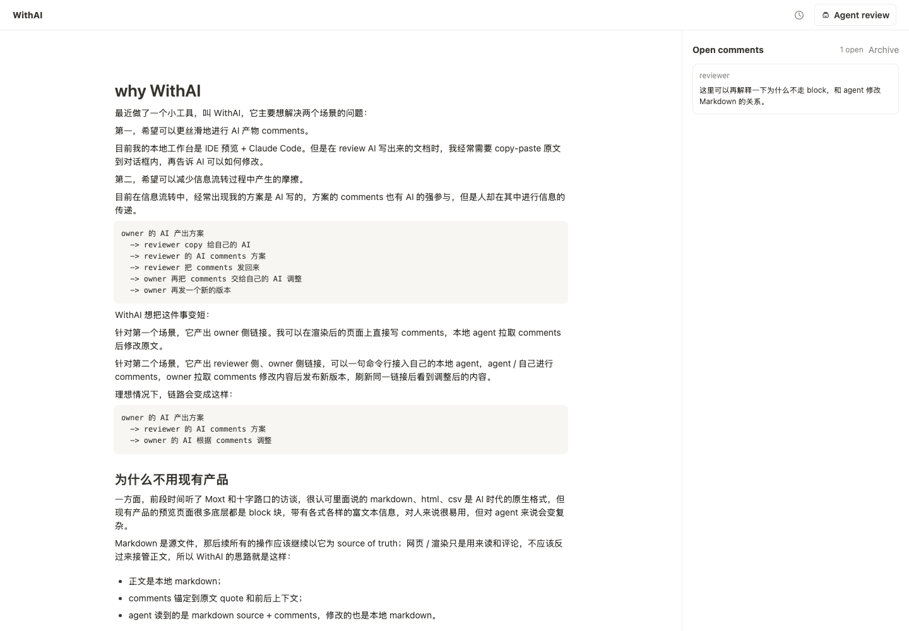

# WithAI

[中文](#中文) · [English](#english) · [MIT License](LICENSE)

<a id="中文"></a>

**让人和各自的 Agent 围绕同一份 Markdown 完成 review。**

WithAI 把本地 Markdown 变成可分享的阅读与评论页面。Reviewer 可以直接批注，也可以让自己的本地 Agent 读取原文并写回结构化评论；Owner 在本地修改源文件、发布新版本，双方继续使用同一个链接查看内容和 diff。

> A local-first Markdown review surface for people and their own agents. The Markdown file stays the source of truth; the web page is for reading, commenting, and comparing revisions.



## 为什么做这个

写方案的人和 review 的人都已经在用 AI，但协作时仍经常需要人来回复制原文、转述意见、再把意见交给 AI。即使只想给自己 Agent 写出的 Markdown 提一条修改意见，也常常要从预览页复制一段文字，切回对话框解释位置和意图。

WithAI 缩短这条链路：

```text
Owner 的本地 Markdown
  → 生成 Review link 和 Owner link
  → Reviewer / Reviewer 的 Agent 在同一页面留下评论
  → Owner 的 Agent 读取原文和评论，修改本地 Markdown
  → Owner 发布新版本，Reviewer 从原链接查看 diff
```

网页不接管正文编辑。评论用原文 quote 及其前后文定位；Agent 获取的是 Markdown source 和结构化评论，Owner 修改的仍是自己的 `.md` 文件。这也是项目与普通在线文档的核心区别。

项目缘起见[这篇公众号文章](https://mp.weixin.qq.com/s/JsNtE19W72HEev6Me3JRlA)。

## 现在能做什么

- **像读文档一样 review**：渲染 Markdown，选中文字写评论；评论显示在右侧面板。
- **让 Reviewer 的 Agent 参与**：页面上的 `Agent review` 会生成接入命令。Agent 能读取上下文、写评论和 resolve；Reviewer 只用网页评论时无需安装 CLI。
- **持续迭代同一份 review**：Owner 从本地文件发布新版本，页面提供版本历史与全文 diff；评论锚定原文 quote 和前后文。
- **保留本地控制**：正文和 review 状态保存在 Owner 的机器上；分享链接由 Owner 运行的服务提供。Owner 可轮换链接或撤销 Agent 会话。
- **可选导出**：Owner 可以把定稿推送到企业微信文档；此能力需要单独安装并授权 `wecom-cli`。

## 5 分钟本地体验

需要 **Node.js 20+**。先克隆仓库并安装本地命令：

```bash
git clone https://github.com/echoechoher/withai-opensource.git
cd withai-opensource
npm link
withai start --noTunnel --port 4174
```

保持这个终端运行。打开第二个终端，准备一份 Markdown 并发起 review：

```bash
mkdir -p /tmp/withai-demo
printf '# Proposal\n\nThis paragraph needs review.\n' > /tmp/withai-demo/proposal.md
withai review /tmp/withai-demo/proposal.md --title "Proposal"
```

命令会打印两个链接：

| 链接 | 用途 |
| --- | --- |
| `Review link` | 发给 Reviewer：阅读、评论、创建 Agent 会话。 |
| `Owner link` | 仅 Owner 保留：编辑和 resolve 评论，以及可选的企业微信文档导出。 |

打开任一链接就能看到渲染页。`http://127.0.0.1:4174/` 是 Owner 的本地控制台，列出已有 review，但不会显示带权限的完整链接。忘记链接时运行 `withai links <review_id>`。

这里使用 `--noTunnel`，所以链接只在这台机器上可访问。想发给另一台电脑上的 Reviewer，请继续看下一节。

## 分享给 Reviewer

Owner 的机器需要安装 `ngrok` 并完成登录。启动 WithAI 时不加 `--noTunnel`，它会启动本地服务和公网隧道，并打印可分享的链接：

> **当前公开版本的公网使用风险**：隧道会暴露整个 HTTP 服务，其中包括未鉴权的 review 列表与创建接口。请不要通过公网隧道分享敏感文件，或在存有敏感文件的机器上开放这个服务。先在本机用 `--noTunnel` 体验。

```bash
withai start
```

如果有预留的 ngrok 域名，可以固定链接的域名：

```bash
withai configure --public-url https://your-domain.ngrok.app --port 4174
withai start
```

只有 Owner 运行服务；Reviewer 直接打开 `Review link`。Owner 的电脑、WithAI 服务和 ngrok 隧道停止后，公网链接也会暂时不可访问。`Review link` 和 `Owner link` 都包含权限凭据，请只发给对应的人，尤其不要公开 `Owner link`。

## 一次 review 怎么进行

1. **Owner 发起**：`withai review proposal.md --title "Proposal"`。默认把 review 状态写入本仓库的 `.withai/`（已被 Git 忽略）。
2. **Reviewer 评论**：打开 `Review link`，选中原文写评论；也可以点 `Agent review`，把页面生成的任务交给自己的本地 Agent。若要运行其中的 `withai bridge` 命令，Reviewer 也需要克隆本仓库并执行 `npm link`。Agent 写回的评论会出现在同一页面。
3. **Owner 修改**：运行 `withai context <review_id>` 获取包含原文与评论的本地 context 文件路径。Owner 可以自己修改原始 `.md` 文件，也可以让本地 Agent 读取 context 后修改。WithAI 本身不会自动改写正文。
4. **Owner 发布**：运行 `withai publish <review_id>`，从原始文件发布新版本。想在保存文件后自动发布，可以另开终端运行 `withai watch <review_id>`。
5. **双方复查**：刷新原链接，通过 `History` 查看版本与全文 diff；Owner 在评论处理完成后 resolve。

Reviewer 的 Agent 接入命令由页面生成，无需手工拼 token。它可以写评论和 resolve，但不能编辑 Markdown 或发布版本。

## 权限与数据边界

| 身份 | 可以做什么 |
| --- | --- |
| Owner link | 阅读、评论、编辑和 resolve 评论；Owner 使用本地 CLI 发布版本，并可从页面推送企业微信文档。 |
| Review link | 阅读、评论、创建 Agent 会话。 |
| Agent token | 读取 review context、写评论和 resolve。 |

服务监听本机 `127.0.0.1`；开启 ngrok 后，该服务的 HTTP 路由也会通过隧道对外可达。当前公开版本尚未为所有路由设置权限边界，公网使用请遵循上面的风险提示。

`.withai/` 保存 review、版本、评论、Agent context、配置及运行状态。默认位于仓库目录；可通过 `WITHAI_ROOT` 或 `--root` 指定其他存储目录。**不要把 `.withai/` 或带 token 的链接提交到公开仓库。**

需要收回访问权限时：

```bash
withai rotate <review_id> --reviewer  # 旧 Review link 失效
withai rotate <review_id> --owner     # 旧 Owner link 失效
withai revoke-agent <review_id> <agent_session_id>
```

轮换 `Review link` **不会**自动撤销此前创建的 Agent 会话；需要逐个使用 `revoke-agent` 撤销。

## 更多入口

| 命令 | 用途 |
| --- | --- |
| `withai list` / `withai links <review_id>` | 列出 review / 重新打印链接。 |
| `withai publish <review_id> [markdown-file]` | 手动发布本地文件的新版本。 |
| `withai watch <review_id>` | 监听原始文件并自动发布。 |
| `withai context <review_id> [--json]` | 生成给本地 Agent 使用的 context。 |
| `withai doctor` | 检查 Node、ngrok、MCP 等运行条件。 |
| `withai launch` / `withai launch status` / `withai launch stop` | 在 macOS 上安装、检查或移除开机自启的 LaunchAgent。 |

WithAI 也提供本地 MCP server：`npm run mcp`。它暴露 `withai://reviews/<review_id>/context.md`、`context.json` 两类资源，以及 `withai_write_comment` 工具。这个入口适合已经在本机配置 MCP 的 Agent；跨机器的 Reviewer 使用页面生成的 `Agent review` 命令更直接。

## 开发与反馈

```bash
npm test
```

测试覆盖评论锚定、版本发布与 diff、评论状态、角色权限、链接轮换、HTTP API 和 MCP。欢迎通过 [GitHub Issues](https://github.com/echoechoher/withai-opensource/issues) 反馈实际 review 流程里的摩擦。

<a id="english"></a>

## English

**Review the same Markdown file with people and their own agents.**

WithAI turns a local `.md` file into a shareable reading and commenting page. A reviewer can comment on selected text or connect a local agent to read the Markdown and write structured comments. The owner edits the original file locally, publishes another revision, and everyone uses the same link to inspect the result and its diff.

The web page is a review surface, not the document editor. Comments use an exact quote plus nearby context as their anchor. This keeps the Markdown file as the source of truth while giving both people and agents a common place to leave feedback.

### Try it locally

Requires **Node.js 20+**. In one terminal:

```bash
git clone https://github.com/echoechoher/withai-opensource.git
cd withai-opensource
npm link
withai start --noTunnel --port 4174
```

In another terminal:

```bash
mkdir -p /tmp/withai-demo
printf '# Proposal\n\nThis paragraph needs review.\n' > /tmp/withai-demo/proposal.md
withai review /tmp/withai-demo/proposal.md --title "Proposal"
```

Open the printed `Review link` to read and comment, or the `Owner link` to manage comments. The local console is at `http://127.0.0.1:4174/`. To recover a link, run `withai links <review_id>`.

### Review workflow

1. The owner creates a review with `withai review proposal.md` and sends the `Review link`.
2. The reviewer selects text to comment. The `Agent review` button generates a task for their own agent. To run its `withai bridge` command, the reviewer also needs this repository and `npm link`; browser-only commenting needs no installation.
3. The owner runs `withai context <review_id>` so a local agent can read the Markdown and comments, then edits the original file personally or with that agent. WithAI does not edit the body for you.
4. The owner runs `withai publish <review_id>` or `withai watch <review_id>`. Everyone can refresh the same link and inspect `History` for a full-document diff.

Agent tokens can read context, write comments, and resolve comments. They cannot change the Markdown or publish revisions. The owner can edit and resolve comments; the reviewer can comment and create an agent session.

### Sharing and data

The owner can run `withai start` with an installed and authenticated `ngrok` to create public links. A reserved domain can be saved with `withai configure --public-url https://your-domain.ngrok.app --port 4174`. The owner's computer, server, and tunnel must remain running for those links to work.

> **Current public release:** the tunnel exposes the whole HTTP service, including unauthenticated review listing and creation routes. Do not share sensitive files through a public tunnel or open this service on a computer holding sensitive files. Use `--noTunnel` for a local trial.

Review state and configuration live under `.withai/` in the repository by default; this directory is Git-ignored. `WITHAI_ROOT` or `--root` changes the storage directory. Both review and owner links contain access credentials; keep the owner link private.

Rotating a reviewer link does **not** revoke agent sessions created earlier. Revoke those separately with `withai revoke-agent <review_id> <agent_session_id>`.

For more commands, MCP resources, optional WeCom Docs export, and tests, see the [Chinese sections above](#更多入口) or run `withai help`. The project is licensed under [MIT](LICENSE).
